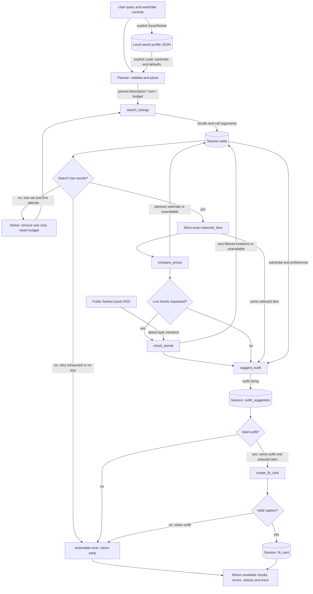

# FitFindr implementation plan

The original required-feature plan was present in the upstream project. The
stretch plan at the end of this file was written before stretch code on
2026-11-17. These main sections describe the final implemented behavior.

## Tools

### Tool 1 — search_listings

Signature: `search_listings(description: str, size: str | None = None,
max_price: float | None = None) -> list[dict]`.

Inputs: `description` is item/style text, `size` an optional whole-token size,
`max_price` an optional inclusive dollar ceiling. Use the provided `load_listings`
helper. Filter size and budget before weighted keyword ranking; price breaks ties.
Return ranked listing dictionaries with id/title/description/category/size/condition/
platform (str), style_tags/colors (list[str]), price (number), brand (str or None).
Blank/no-match/read-failure returns `[]`; skip invalid listing prices. On empty
results the agent retries once without size if a size was given, otherwise returns
an actionable error. No item means no outfit or caption call.

### Tool 2 — suggest_outfit

Signature: `suggest_outfit(new_item: dict, wardrobe: dict) -> str`.

Inputs: `new_item` is the exact selected listing; `wardrobe` has an items list
with named pieces/category/colors/style_tags and optional `style_preferences`
(str). Send item facts, owned pieces and preferences to Groq, using `GROQ_MODEL`
(default `openai/gpt-oss-20b`). Return one or two complete outfit suggestions as a
string. Empty wardrobe asks for general pairings without claiming ownership.
Missing item/provider error/empty model output returns a descriptive error string;
the planner stores it in `error`, retains the listing and skips the card.

### Tool 3 — create_fit_card

Signature: `create_fit_card(outfit: str, new_item: dict) -> str`.

Inputs: `outfit` is the exact successful outfit string; `new_item` the same listing
object. Send both to Groq with temperature 1.0. Return a 2–4 sentence shareable
caption grounded in the item title, price, platform and outfit. Missing inputs or
provider/empty-output failure returns an actionable error string. On failure set
session.error and leave fit_card=None; keep the valid outfit visible.

### Tool 4 — compare_prices (stretch)

Signature: `compare_prices(new_item: dict) -> dict`.

Input is the selected listing. Load other same-category records sharing a style
tag, excluding its ID. Need at least two peer prices. Return status
(ok/insufficient_data/unavailable), comparable_ids (list[str]), count (int),
median_price (float or None), difference_pct (float or None), verdict (str),
message (str). More than 15% above/below the peer median means above/below typical;
otherwise fair. Explain that these are mock asking prices, without condition,
brand or shipping normalization. Malformed data/read failure returns unavailable;
insufficient peers returns insufficient_data. Neither blocks the required tools.

### Tool 5 — check_trends (stretch)

Signature: `check_trends(size: str | None = None) -> dict`.

Input optionally filters available mock sizes. Read Who What Wear's public RSS
feed, bounded to 8 seconds and 8 MB. Count local style-tag mentions in recent post
titles/descriptions/categories within 30 days; exclude future/undated posts and
deduplicate source links per style. Return status (ok/empty/unavailable), source
(URL str), checked_at (UTC ISO str), window_days (int), size (str or None),
posts_checked (int), trends (list[dict]), message (str). Each of up to five trends
contains style (str), post_count (int), listing_ids (list[str] filtered by size),
and up to three sources (dicts with title/url/published_at strings). Rank by count
then name. Explicitly distinguish sampled editorial mentions from global popularity
and from authors' sizes. Feed/network failure returns unavailable and advice;
no matching evidence returns empty. Both are advisory, so styling continues.
Only call when the user enables the live checkbox and a listing was selected.

## Planning Loop

`run_agent(query: str, wardrobe: dict, profile: dict | None = None,
include_trends: bool = False) -> dict` is conditional orchestration (equivalent
reasoning mechanism), with bounded retry rather than an unconditional tool list.

1. Initialize the session. Empty query or invalid profile sets error and returns.
2. Parse description, optional size and maximum price using regex. If a profile
   is loaded, substitute its wardrobe/preferences and fill only omitted size/budget.
   Explicit query values win. Keep parsed constraints as originally requested.
3. Record and call search_listings with these constraints. Record result count.
4. If empty and size exists, append a notice and retry once with size=None.
   Keep the description and budget unchanged. Record retry arguments/count.
   If size was absent, do not retry. There is no automatic price increase.
5. If still empty, set error with failed constraints and alternatives, and return
   before compare_prices, check_trends, suggest_outfit or create_fit_card.
6. Store results and exact selected_item=results[0]. Call compare_prices; store its
   advisory result. If include_trends is true, call check_trends with the originally
   requested size and store evidence. Their returned failure statuses are nonfatal.
   If size was relaxed, also show actual selected size and the fit warning.
7. Call suggest_outfit(selected_item, wardrobe). Save returned string. If empty or
   starting with the tools' error prefixes (`I need ` / `I couldn't `), set error
   and return before card creation. These prefixes are a documented internal
   string-result convention; no separate structured LLM error schema is claimed.
8. Call create_fit_card(outfit_suggestion, selected_item). On a successful string,
   set fit_card. On empty/error output, set error and retain earlier valid outputs.
9. Return session to the UI. It shows notices/errors, available results and trace.

## State Management

One transient session dictionary is the source of truth for each interaction:

- query and parsed: original text and effective description/size/max_price.
- wardrobe: chosen or loaded items plus style_preferences.
- search_attempts: parameters and counts for each actual search (maximum two).
- search_results and selected_item: ranked list and the exact first dict object.
- price_comparison and trends: advisory results; trends is None when not requested.
- outfit_suggestion: exact outfit output passed directly to create_fit_card.
- fit_card: successful caption only; remains None on failure.
- error, notices and tool_calls: final failure, adjustments and executed tool order.

No intermediate output needs user re-entry. Tests assert the item object identity
in both later calls and equality of the original outfit passed to the card tool.
Persistent style memory is separate: ProfileStore explicitly saves version,
wardrobe, style_preferences, size and max_price to local JSON. Save/load/delete
use hashed profile names; writes are atomic. A separate instance or restarted app
can load the same file. Query/history/API keys are never saved. Invalid JSON or
schema produces corrective UI feedback. Names are local identifiers, not logins.

## Error Handling

| Tool/component | Specific failure | Specific agent response / action |
| --- | --- | --- |
| search_listings | No size-constrained matches | Retry once without size; say “your budget is unchanged” and ask to check seller measurements. Show actual selected size. |
| search_listings | Retry still empty or dataset cannot load | “I couldn't find listings matching … Try a broader description, a different size, or a higher price limit.” Stop before styling. If known items fail, check data/listings.json. |
| suggest_outfit | Empty/minimal wardrobe | Ask Groq for complete general pairings; do not invent owned items. |
| suggest_outfit | Missing item | “I need a valid thrifted item before I can suggest an outfit.” Stop. |
| suggest_outfit | Injected API exception | “I couldn't generate an outfit suggestion. Check GROQ_API_KEY and GROQ_MODEL in .env, your connection, and Groq limits; then retry.” Keep listing; skip card. |
| create_fit_card | Empty outfit | “I need a complete outfit suggestion before I can create a fit card.” Do not crash. |
| create_fit_card | Missing selected item | Request the selected thrifted item before card creation. |
| create_fit_card | Provider failure | Explain the fit-card call failed, keep the valid outfit, and ask to check credentials/model/connection/limits then retry. |
| compare_prices | Too few peers / read failure | Return insufficient_data/unavailable, suggest manual comparison; continue styling. |
| check_trends | Timeout, blocked feed, malformed feed | “Live trend check unavailable. Check your connection and try again; your outfit search can continue.” No invented trends. |
| profile memory | Missing/corrupt profile or invalid editor JSON | Explain what to correct or save; failed load leaves existing editor values intact. |

The failure-injection tests raise actual RuntimeError exceptions from the model
call; they verify the response is actionable, secrets/internal exception text are
not echoed, and later tools do not run. This differs from the valid no-results path.

## Architecture

## AI Tool Plan

**Required tools:** provide ChatGPT/Codex with each individual Tools block, exact
starter signature, load_listings helper and listing/wardrobe schemas. Request one
function at a time. Review signatures and return shapes against the Tool block;
verify filtered search, empty wardrobe, empty caption input and API exceptions with
pytest before orchestration. Generated model wording still needs live human review.

**Orchestration:** provide Planning Loop, State Management, Error Handling and the
Architecture text diagram, plus starter agent.py. Request conditional state handoffs.
Reject unconditional tool sequences and user re-entry. Verify no-results stops,
item identity, outfit argument flow and provider-failure short circuits with mocks.

**Stretch:** provide the pre-code Stretch implementation plan below and the same
Tools/Planning Loop/State Management sections. Direct Codex to preserve the three
required interfaces, add advisory price and trend results, explicitly saved local
profiles and bounded size-only retry. Review price peer exclusion/median, query
overrides, profile persistence, dated source links, and unchanged retry budget.
Verify using tests/test_stretch.py plus live RSS and Gradio callback checks.
Override retired provider assumptions after consulting official documentation.

**Documentation/UI:** provide final session fields, actual tool signatures and
verification output. Check README agrees with code and this plan. Retain an explicit
video TODO and do not describe agent review as student review or mocked outputs as
live generation. No AI tool can verify the student's own narration or review.

## A Complete Interaction (Step by Step)

FitFindr receives a natural-language item request and uses a real mock listing
before generating outfit and caption text. Each later tool receives the prior
output from session state. Errors produce specific advice and stop or use the
planned fallback, rather than passing missing data into later tools.

Example: `I'm looking for a vintage graphic tee under $30`, example wardrobe.

1. Parse description=`a vintage graphic tee`, size=None, max_price=30.0.
   Call search_listings with those exact values; save ranked results. Current
   dataset selects lst_006, “Graphic Tee — 2003 Tour Bootleg Style”, $24, depop,
   size L. Save that exact dict to selected_item.
2. Call compare_prices(selected_item) to estimate fairness from other mock items.
   If live trends are checked, also call check_trends(None); retain dated sources.
   Advisory failure never discards the selected listing.
3. Call suggest_outfit(session.selected_item, session.wardrobe). The owned jeans
   and sneakers are in the prompt. Save the model's exact returned string to
   outfit_suggestion. If this call fails, show listing and corrective advice.
4. Call create_fit_card(session.outfit_suggestion, session.selected_item). Save a
   successful 2–4 sentence caption to fit_card. The UI shows all three panels,
   price/trend evidence if present, and executed tool trace.

Nonstandard: `graphic tee size XXS under $30` first returns []; retry with size=None
and the same $30 ceiling. Show size warning before styling. `designer ballgown size
XXS under $5` returns [] twice and ends with no outfit/card calls. Deliberately
injecting a Groq exception after a successful search retains the listing, tells
the user to check key/model/connection/limits, and skips card generation.

---
## Stretch implementation plan (2026-11-17, before stretch code)

1. **Price comparison:** `compare_prices(new_item: dict) -> dict` loads the dataset,
   excludes the selected ID, and compares same-category items sharing a style tag.
   Return status, comparable IDs/count, median price, percentage difference, verdict,
   and explanation. Under two comparables means insufficient evidence; errors are
   advisory and must not prevent an outfit.
2. **Style memory:** store wardrobe, free-text style preferences, default size and
   default budget as a versioned local JSON profile. Use a hashed profile name,
   atomic writes and explicit Save/Load/Delete UI actions. Never save credentials
   or silently overwrite profiles. Merge saved defaults only when a query omits
   the size/budget. Explicit query values win; include preferences in outfit prompts.
3. **Trend awareness:** `check_trends(size: str | None = None) -> dict` reads recent
   public r/streetwear Atom posts (30-day window), counts dataset style-tag mentions
   and returns dated source links, observed counts and matching listing IDs filtered
   to size. Public posts do not establish the posters' sizes: explicitly label this
   as recent discussion signals with local size availability, not global popularity.
   The UI opts into a live check. Timeout, blocked feed or no evidence means a clear
   unavailable/empty result, never fabricated trends; the main workflow continues.
4. **Search retry:** when the first search is empty and size exists, retry exactly
   once with size=None and the same description/budget. Record both attempts and
   tell the user the size changed, including the selected item's actual size.
   Never silently raise the budget. If still empty, stop before generative tools.

Verification: isolate tools with pytest fixtures, including malformed feed and
injected network/API failures; test retry call arguments and the unchanged budget,
exact object identity across tools, profile reload through a separate store instance,
query override precedence, UI preservation of partial results, and live-feed failure.
Keep the required tool signatures unchanged. Update the diagram and inventories
alongside implementation. Tests use mocked model output, not claims of live Groq QA.

### Provider verification before implementation
The public Who What Wear RSS feed (`https://www.whowhatwear.com/feeds.xml`)
returned HTTP 200 during setup; use this public fashion platform rather than Reddit
RSS, whose availability has changed. Parse RSS `item` title/description/category,
link and pubDate. The same 30-day evidence and size-availability rules apply.
Groq's current deprecation docs report that Scout shut down July 17, 2026.
Use configurable `GROQ_MODEL`, default `openai/gpt-oss-20b` from its current model
catalog; document this necessary divergence from the course's older model choice.
